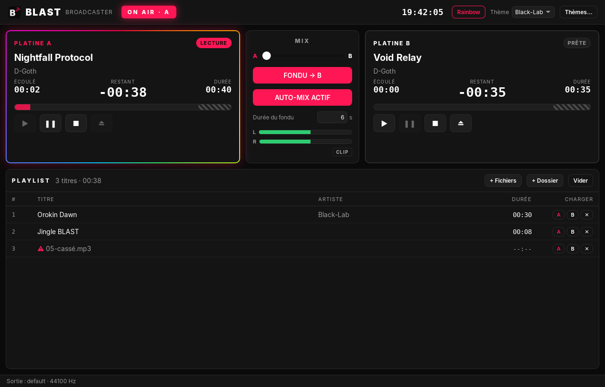

# BLAST Broadcaster

**Black-Lab Audio Streaming Tool** — console de webradio et de live multi-OS (Linux et Windows ; macOS prévu).

BLAST Broadcaster réunit dans un seul logiciel ce qu'il fallait jusqu'ici assembler à la main :
la console d'antenne d'une webradio (à la manière de SAM Broadcaster), la diffusion vers les serveurs
de streaming audio, et le pilotage d'un live vidéo avec webcams et chat (talk show, live DJ, émission).



> Statut : **piliers 1 et 3**. Deux platines avec bouton Suivant, crossfader, auto-mix, playlist, diffusion MP3 vers Icecast et Shoutcast, Voice FX, Sound FX (36 pads) pilotage d'OBS, historique de diffusion avec règles de séparation, traitement audio antenne et effets de voix. Historique typé (morceaux, jingles, pubs) avec box à jingles. Prochaines étapes : clockwheels (pilier 2) et chat (M8).

## Fonctionnalités prévues

**Antenne**
- Platines A/B (jusqu'à 4), crossfade automatique ou manuel, cue points, pré-écoute (PFL) sur sortie casque séparée
- Soundbox (cart wall) : jingles, virgules, effets, sur raccourcis clavier ou contrôleur MIDI
- File d'attente éditable en direct, auto-DJ avec rotations (clockwheels) et règles de séparation
- Micro avec ducking automatique, traitement audio (AGC, compresseur, limiteur, égaliseur)
- Voice tracking

**Diffusion**
- Plusieurs sorties simultanées : MP3, AAC, Opus, Ogg Vorbis, FLAC
- Serveurs Icecast, Shoutcast v1 et v2, métadonnées « titre en cours »
- Historique de diffusion exportable

**Live**
- Pilotage complet d'OBS Studio via obs-websocket (module Aura)
- Chat agrégé Twitch, YouTube, Kick, avec commandes viewers (`!request`, `!np`, `!sfx`)
- Overlay « Now Playing » automatique

**Interface**
- Thèmes personnalisables et partageables (Light, Dark et Black-Lab fournis)
- Couleur par platine, mode rainbow optionnel synchronisé au BPM

## Modules

| Crate | Rôle |
|---|---|
| `blast-core` | Moteur audio : platines, mixage, crossfade, traitement |
| `blast-cast` | Encodeurs et envoi vers les serveurs de streaming |
| `blast-library` | Bibliothèque musicale, file d'attente, automatisation |
| `blast-aura` | Pilotage d'OBS Studio |
| `blast-live` | Chat, commandes viewers, invités |
| `blast-cli` | Outil `blast` en ligne de commande pour tester le moteur |
| `app/src-tauri` | Application de bureau (Tauri) : contrôleur, playlist, thèmes |
| `app/ui` | Interface HTML/CSS/JS |

Voir [docs/ARCHITECTURE.md](docs/ARCHITECTURE.md) et [ROADMAP.md](ROADMAP.md).

## Installer sous Linux (Kubuntu, Ubuntu, Debian)

```bash
sudo apt install build-essential pkg-config curl git \
    libasound2-dev libwebkit2gtk-4.1-dev libgtk-3-dev librsvg2-dev libsoup-3.0-dev
curl --proto '=https' --tlsv1.2 -sSf https://sh.rustup.rs | sh
source "$HOME/.cargo/env"

git clone https://github.com/D-Goth/BLAST-Broadcaster.git
cd BLAST-Broadcaster
./scripts/install-linux.sh
```

Le script compile, puis installe pour l'utilisateur courant (sans `sudo`) :
- **BLAST Broadcaster** dans le menu des applications (Multimédia), avec son icône ;
- la commande `blast-broadcaster` (et l'outil de test `blast`) dans `~/.local/bin`.

Pour mettre à jour : `git pull` puis relancer le script. Pour désinstaller : `./scripts/install-linux.sh --uninstall`.

Sous Fedora : `sudo dnf install alsa-lib-devel webkit2gtk4.1-devel gtk3-devel librsvg2-devel libsoup3-devel`.
Les captures OBS (SNAP) vont dans `~/Images/BLAST`.
PipeWire et PulseAudio sont pris en charge via leur couche de compatibilité ALSA.

## Installer sous Windows 10 / 11

Tout se fait dans l'**Invite de commandes** (`cmd`), pas besoin de PowerShell.

**1. Les outils (une seule fois)**

```bat
winget install --id Git.Git -e
winget install --id Rustlang.Rustup -e
winget install --id Microsoft.VisualStudio.2022.BuildTools -e --override "--wait --passive --add Microsoft.VisualStudio.Workload.VCTools --includeRecommended"
```

Sans winget : [Git pour Windows](https://git-scm.com/download/win), [rustup](https://rustup.rs) (il propose d'installer
les outils C++ de Visual Studio : accepte). WebView2, utilisé pour l'interface, est déjà présent sur Windows 10 et 11.
**Ferme puis rouvre l'invite de commandes** après ces installations.

**2. Récupérer et installer BLAST**

```bat
git clone https://github.com/D-Goth/BLAST-Broadcaster.git
cd BLAST-Broadcaster
scripts\install-windows.bat
```

Le script compile, copie BLAST dans `%LOCALAPPDATA%\Programs\BLAST Broadcaster` et crée l'entrée
**BLAST Broadcaster** dans le menu Démarrer (clic droit → Épingler à la barre des tâches).

- Mettre à jour : `git pull` puis `scripts\install-windows.bat`
- Désinstaller : `scripts\install-windows.bat /uninstall` (les réglages restent dans `%APPDATA%\fr.black-lab.blast`)

Sous Windows, les mots de passe sont rangés dans le Gestionnaire d'identifiants, et le son passe par WASAPI.
Les captures OBS (SNAP) vont dans `Images\BLAST`.

## Utiliser l'interface

| Action | Comment |
|---|---|
| Ajouter des titres | **+ Fichiers** (sélection multiple), **+ Dossier** (sous-dossiers compris), ou glisser depuis Dolphin sur la playlist |
| Charger une platine | Glisser un titre (ou un fichier depuis Dolphin) sur la platine, boutons **A** / **B** de la ligne, ou double-clic (platine libre) |
| Réordonner | Glisser un titre dans la playlist |
| Enchaîner | **FONDU → A/B** démarre l'autre platine et fond vers elle, puis arrête la précédente |
| Auto-mix | Pioche dans la playlist et enchaîne tout seul, avec la durée de fondu choisie (zone hachurée sur la barre de progression) |
| Titre suivant | Bouton **⏭** d'une platine : fondu vers l'autre platine ; si elle est vide, le prochain titre de la playlist y est chargé puis enchaîné |
| Se déplacer | Cliquer sur la barre de progression |
| Micro | **Appuyer pour parler** (ou **Espace** maintenu) : ouvert tant qu'on appuie ; **🔒 VERROU** (ou touche **M**) : verrouille le micro ouvert, re-cliquer pour le refermer |
| Retour micro | **Réglages → Audio** : le micro part toujours vers la diffusion ; « Entendre mon micro » le renvoie aussi vers les enceintes/le casque (désactivé par défaut, pas d'écho ni de Larsen) |
| Ducking | **AUTO** : la musique baisse automatiquement (niveau réglable, -12 dB par défaut) quand le micro est ouvert |
| Égaliseur micro | Grave, médium, aigu (±12 dB) et coupe-bas ; volume micro et volume musique séparés |
| Effets voix | Sélecteur dans l'en-tête du Voice FX : Naturel, Podcast chaleureux, Voix radio FM, ASMR, Radio TSF 1930, Téléphone, Mégaphone (porte de bruit, filtres, saturation « lampe », compresseur, de-esser, souffle et craquements selon l'effet) |
| Son antenne | Sélecteur **Son** du panneau MIX : Aucun traitement, Doux, Radio FM, Puissant (AGC, compresseur, limiteur à anticipation). Le VU **RÉD** montre la réduction de gain appliquée |
| Historique | Onglet **HISTORIQUE** de la playlist : chaque passage avec l'heure, le type (morceau, jingle, pub), la durée réellement diffusée, l'état de la diffusion et le nombre d'auditeurs ; filtres **Tout / Morceaux / Jingles / Pubs** ; **Exporter…** par catégorie et par période (mois en cours par défaut), pour les bilans et les déclarations de droits |
| Verre dépoli | **Réglages → Apparence** : choisis une image de fond, les panneaux deviennent translucides et floutés par-dessus ; flou, opacité et assombrissement réglables en direct, désactivable à tout moment |
| Jingles | Onglet **JINGLES** à côté de la Sound FX : **Dossier…** choisit le dossier de tes jingles, clic sur un jingle pour le lancer à l'antenne par-dessus la musique (re-clic = stop), volume et **STOP** propres. Les fichiers rangés dans un dossier nommé « Jingles » ou « Pubs » (mots-clés réglables dans Réglages → Automation) sont aussi reconnus dans la playlist |
| Règles de séparation | **Réglages → Automation** : pas le même artiste avant 120 min, pas le même titre avant 240 min (réglables). L'auto-mix et le bouton Suivant sautent les titres en attente, marqués d'une horloge dans la playlist |
| Soundboard | 36 pads sur 3 pages ; clic ou **F1 à F12** pour jouer (re-clic = stop), **STOP** coupe tout ; glisser un fichier (ou un titre de la playlist) sur un pad pour l'assigner ; clic droit : choisir, renommer, vider |
| Thèmes | Sélecteur en haut à droite ; **Thèmes…** indique le dossier où déposer tes propres fichiers `.toml` |
| Diffuser | **Réglages → Diffusion** : ajouter une sortie (Icecast, Shoutcast v1 ou v2), **Tester la connexion**, **Enregistrer** ; puis bouton **DIFFUSER** dans la barre du haut |
| OBS | **Réglages → Aura / OBS** : adresse, port, mot de passe et source texte « Now Playing » ; puis onglet **AURA · OBS** (à côté de SOUND FX) ou bouton **OBS** de la barre du haut |
| Pilotage OBS | STREAM, REC, PAUSE REC, REPLAY, SNAP (capture dans `~/Images/BLAST`), MUTE et volume d'une source audio, changement de scène ; minuteurs ▶ stream et ⏺ enregistrement dans la barre du haut |

**Diffusion** : le bouton passe au vert (**EN DIRECT n/n**) quand toutes les sorties actives sont connectées.
Il affiche aussi la **durée de diffusion** et le **nombre d'auditeurs** (👤 en cours · max), relevés toutes les 10 secondes
sur le serveur (`status-json.xsl` pour Icecast, `7.html` pour Shoutcast v1, `stats` pour Shoutcast v2). Le détail par sortie
est dans l'infobulle du bouton et dans Réglages → Diffusion. En cas de coupure,
BLAST se reconnecte tout seul toutes les 5 secondes ; un mot de passe refusé arrête la sortie concernée.
Le titre en cours (« Artiste - Titre » de la platine à l'antenne) est envoyé au serveur à chaque changement.

**Mots de passe** : rangés dans le trousseau du système (KWallet sous KDE), jamais dans le fichier de réglages.
Si le trousseau est indisponible, BLAST le signale et garde le mot de passe en mémoire pour la session uniquement.
Les autres réglages sont dans `~/.config/fr.black-lab.blast/config.toml`.

Le micro se choisit dans **Réglages → Audio** (pris en compte au redémarrage). Le VU-mètre MIC montre le niveau
d'entrée même micro fermé, pour régler son gain avant de prendre l'antenne.

Un titre chargé mais pas encore joué, remplacé par un autre, retourne en tête de playlist.
Les fichiers illisibles restent dans la playlist, marqués ⚠, et sont sautés par l'auto-mix.

## Mettre à jour

BLAST vérifie au démarrage si une nouvelle version est publiée sur GitHub et te prévient
(désactivable dans **Réglages → À propos**, où se trouve aussi le bouton « Vérifier maintenant »).
Rien n'est téléchargé automatiquement. Pour mettre à jour, dans le dossier du projet :

- Linux : `git pull && ./scripts/install-linux.sh`
- Windows (invite de commandes) : `git pull` puis `scripts\install-windows.bat`

En cas de souci, l'onglet **À propos** ouvre le dossier du journal `blast.log` (aucun mot de passe n'y figure).

## Développer

```bash
cargo build --release
cargo test
./target/release/blast-broadcaster ~/Musique
```

Le code ne contient pas de commentaires : chaque élément porte un code de référence (`// [MIX-12]`)
défini dans [docs/NOMENCLATURE.md](docs/NOMENCLATURE.md). Après une modification, régénérer ce document :

```bash
python3 scripts/nomenclature.py          # régénère docs/NOMENCLATURE.md
python3 scripts/nomenclature.py --check  # ce que vérifie la CI
```

La CI GitHub (Linux et Windows) vérifie le formatage, clippy sans avertissement, les tests et la nomenclature.
Elle utilise une version de Rust figée (`.github/workflows/ci.yml`) : on la monte volontairement, pour qu'une
nouvelle règle de clippy ne casse pas la CI sans prévenir.

## Outil de test en ligne de commande

```bash
./target/release/blast devices
./target/release/blast info ~/Musique/*.mp3
./target/release/blast play titre1.mp3 titre2.flac jingle.ogg --fade 6
./target/release/blast render titre1.mp3 titre2.flac -o mix.wav --fade 6
```

| Commande | Rôle |
|---|---|
| `devices` | Liste les sorties audio (`*` = sortie par défaut) |
| `info` | Durée, fréquence d'origine et tags de chaque fichier |
| `play` | Joue la liste en alternant les platines A et B, avec fondu enchaîné automatique |
| `render` | Calcule le même mix hors-ligne et l'écrit en WAV, pour vérifier sans enceintes |

Options utiles : `--fade <secondes>`, `--device "<nom>"` pour `play`, `--rate` et `--pcm16` pour `render`.

Formats lus : MP3, AAC/M4A, ALAC, FLAC, Ogg Vorbis, WAV, AIFF, MKV/WebM audio. Les fichiers sont rééchantillonnés à la fréquence de la sortie.

## Licence

- **Code** : [PolyForm Noncommercial 1.0.0](LICENSE) — libre pour tout usage non commercial (personnel, associatif, éducatif, recherche).
- **Ressources** (thèmes, documentation, visuels) : [CC BY-NC 4.0](LICENSE-ASSETS).
- **Nom et logo** : non couverts par ces licences, voir [TRADEMARK.md](TRADEMARK.md).

Pour un usage commercial, contacter l'auteur.

---

© 2026 Loïc HERAUDEAU (D-Goth) — [black-lab.fr](https://black-lab.fr)
